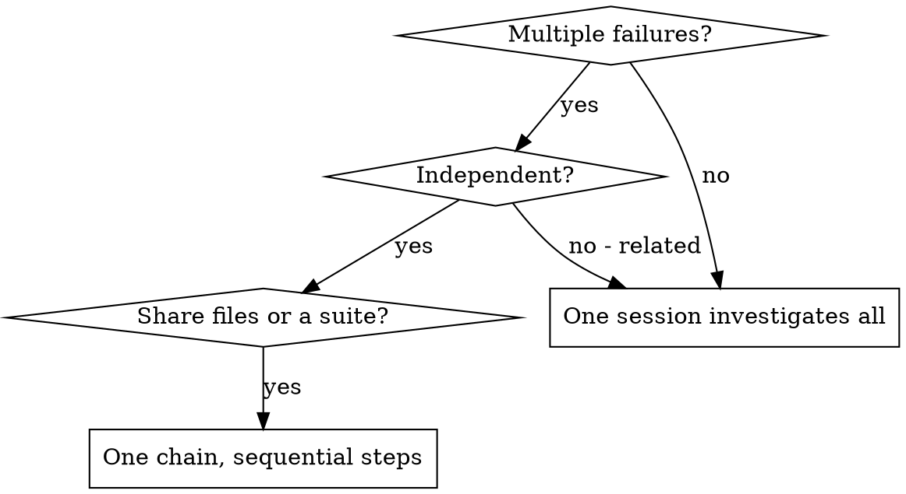

# Parallel Agents

## Overview

When several problems are genuinely independent, investigating them one after another wastes the
one resource that is actually scarce: your context. Each investigation is its own question, and a
session that answers it can start with a clean window.

**Core principle:** one problem domain, one session. Independence is the precondition, not a
preference.

## How this harness does it

There is no dispatch-and-wait. Agents ARE sessions: the harness starts a session per chain step and
reacts to a completion fact, and a session does not start children and then block on them.

So parallel work has two shapes here, and picking the wrong one is the common failure:

| Shape | When | How |
| --- | --- | --- |
| **Sequential chain** (the default) | Steps share a repository, a test suite, or a file. | `chain.start` on a plan whose steps are the separate problems. The harness runs them one at a time. |
| **Parallel sessions** (deliberately deferred) | The work is genuinely disjoint and the coordination cost is real. | Not built yet — see below. |

**Sequential is the honest default.** This codebase's work is coupled: every step touches the same
solution and the same test suite. A plan whose steps are "fix test file A, fix test file B, fix test
file C" looks parallel and is not — all three write to the same tree, and the second one's build
sees the first one's half-finished edit.

**Parallel file coordination is a separate, unbuilt piece of work.** Scoped path claims, conflict
prediction, and a serialized landing queue are specified and deliberately deferred. Do not simulate
them by starting sessions that edit the same tree — that produces conflicting edits and a merge
nobody reviewed.

## When the problems really are independent



**Use a chain when:**

- 3+ test files failing with different root causes, each fixable without the others
- Multiple subsystems broken independently
- Each problem can be understood without context from the others
- No step's edit invalidates another step's tests

**Investigate in one session when:**

- Failures are related (fixing one might fix others)
- Understanding requires seeing the whole system state
- The problems touch the same files

## The pattern

### 1. Identify the independent domains

Group the failures by what is broken, not by which file the test lives in:

- "tool approval flow" — a domain
- "batch completion behavior" — a domain
- "abort functionality" — a domain

Each domain is a plan STEP. Fixing tool approval does not change the abort tests, so a reviewer can
judge each step on its own — which is the test for whether the split is real.

### 2. Write each step's detail for a stranger

The brief a step's session receives is rendered from the plan record. That session has your plan and
nothing else: no transcript, no earlier discussion, no memory of what you tried.

Each step's detail must carry:

- **Scope:** the exact files or subsystem — a path, not a theme
- **The failure verbatim:** the test names and the output you actually saw
- **The goal:** what passing means
- **Constraints:** what not to touch
- **What to return:** the outcome, and the evidence for it

### 3. Declare the roles and start

```text
chain.start id=<planId>
```

One implementer step per domain, plus review steps where an independent verdict is worth the round
trip. The harness starts step 1 and advances on each completion — you do not start the next one.

### 4. Read the record, then integrate

When the chain reports `Completed`:

- Read each step's outcome and the ledger's conclusions.
- Check for conflicts the steps could not see — they ran one at a time, but they edited one tree.
- Run the full suite yourself. Each step ran the tests covering its own change.
- Use `finishing-a-development-branch`.

## Common mistakes

**❌ Too broad:** "Fix all the tests" — the session has no scope and no stopping point.
**✅ Specific:** "Fix `agent-tool-abort.test.ts`" — one file, one deliverable.

**❌ No context:** "Fix the race condition" — the session does not know where.
**✅ Context:** the exact test names and the output you saw, verbatim.

**❌ No constraints:** the session refactors the subsystem.
**✅ Constraints:** "change tests only" or "do not touch production code".

**❌ Vague output:** "Fix it" — you cannot tell what changed.
**✅ Specific:** "Return the root cause and the change, with the test output."

**❌ Parallel simulation:** starting several sessions on one tree.
**✅ One chain:** sequential steps, one tree, one landing.

## A real example

**Scenario:** 6 failures across 3 files after a refactor.

| Domain | Failures |
| --- | --- |
| abort handling | 3, timing |
| batch completion | 2, tools not executing |
| approval race | 1, execution count zero |

**Decision:** three independent domains, one shared tree — so a three-step chain, not three
concurrent sessions.

**Result:** each step's session fixed its own file and left the others alone; the chain completed;
the full suite ran once at the end and passed.

## Verification

After the chain completes:

1. **Read each outcome** — what changed and why.
2. **Check for conflicts** — did two steps touch the same code?
3. **Run the full suite** — each step only ran the tests covering its own change.
4. **Spot check** — a session can make a systematic error consistently.

## Related skills

- `executing-a-chain` — what each step's session does.
- `experiment-driven-development` — how the chain is created and read.
- `writing-plans` — the step detail that reaches the session.
