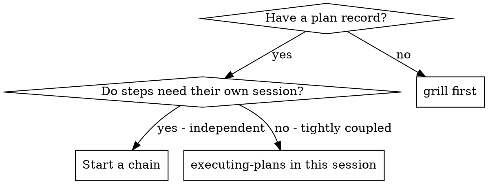

# Experiment-Driven Development

This carries the experiment and external-verdict legs of the scientific loop: each plan step is
an experiment run by a fresh session, and a review step is an external verdict the implementer
cannot self-grade.

Execute a plan as a CHAIN: the plan goes in the database, `chain.start` converts it, and the
harness runs one session per step. The plan, the ledger, the briefs, and the outcomes live in the
database — the record is the work.

**Why sessions instead of one long conversation:** each step gets an isolated context. A session
seeded for step 4 never inherits step 2's history, so it cannot be anchored by a wrong turn taken
twenty messages ago, and it cannot exhaust its window re-reading work that is already recorded.

**Core principle:** fresh session per step + external verdict + the record in the database = high
quality, fast iteration.

**Models:** every session inherits the configured default model. There is no model selection —
never choose, request, or mention models. A review step may name its reviewer's model on the chain
record, and the separation rule enforces that it differs from the implementer's.

**Narration:** between tool calls, narrate at most one short line — the ledger and the tool
results carry the record.

**Rulings, not stalls.** A running chain does not wait on a human. Conflicts, ambiguities, plan
defects, a cap you would have asked to exceed — decide them. The spec is the binding authority,
the plan is its argument, and your judgment settles what neither answers. Record every decision in
the ledger as `Ruling: <what you decided> — <why> — <what it costs if wrong>`, and keep going. A
wrong ruling costs rework your human partner can see and undo; a session parked on a question costs
their whole day and buys nothing.

Four things stop you, and only these: an irreversible or destructive operation; a security-sensitive
action; a side effect outside this workspace that norms say you ask about first (a merge, a push to
a shared branch, a publish); and a plan so broken that every path forward is a guess. For those,
stop and ask.

## When to use this



**A chain, when the steps are separable.** Each step produces a deliverable a reviewer could judge
on its own, and later steps read earlier ones from the record rather than from memory.

**`executing-plans` in this session, when they are not.** If the steps share a tight edit loop — a
refactor whose second half invalidates the first's tests — a chain of sessions spends more on
re-reading context than the coupling saves.

## Setup

Work in an isolated workspace: use `using-git-worktrees` to create one or verify the existing one.
Never start implementation on a main/master branch without your human partner's explicit consent.

### The ledger is chain scope

Every step of a chain reads and writes the SAME key: `sci.<slug>/ledger`, where the slug is derived
from the chain's title by the harness. A refutation recorded by step 3 is step 7's to read.

**The privacy rule, restated for chains:** do not wander into another chain's work. Its ledger
holds its conclusions — how it built what it built — and those describe work you are not doing.
What IS yours to read is every REFUTATION in the workspace, because "approach X does not work
because Y" is a fact about the world rather than about one chain's work, and rediscovering it costs
the next chain real budget. They live in the workspace-visible `refutations/` namespace: search it
with `state.find` before you start, and never write to it by hand — a refuted verdict writes the
shared record for you, in the same call that records the verdict in your own ledger.

> **Where this rule lives, so a rewrite can find it.** File:
> `src/eThangAgent.Skill.Domain/skills/experiment-driven-development/SKILL.md`. Section:
> `### The ledger is chain scope`. Line: 76, as of this writing — but the SECTION is the durable
> pointer, because a line number moves with every paragraph above it. `EmbeddedSkillCatalogTests`
> pins the rule inside that section, so a rewrite that deletes or relocates it fails the build
> instead of leaving a citation pointing at prose that no longer says this.

An empty ledger is normal — the first step of a chain starts with one. Check with
`state.get key="sci.<slug>/ledger"`. A ledger whose identity line names a different chain belongs to
another run: leave it alone.

Record with the `experiment` tool. Its actions are `record-hypothesis`, `record-prediction`,
`record-verdict`, `record-observation`, `record-conclusion`, `record-skip`, `list`, and `summary`.
Parameters are `slug`, `id`, `text`, `falsifiedBy`, `verdict`, and `evidence` — the tool rejects
unknown keys strictly.

The ledger is the recovery map: the commits it names exist in git even when a session's context no
longer remembers creating them. Append one line at a time with `state.append` (CAS by design: pass
`expectedVersion` when resuming after a conflict report; on VersionConflict re-get, reconcile,
retry — never blind-overwrite).

## Writing the plan for a chain

Read the spec first. The plan's `goal` carries it, and the spec is the authority the plan argues
from; conflicts inside the plan resolve against it. A plan with no reachable spec gets a ledger note
saying so — rulings made without one are provisional.

Before starting the chain, scan the plan once for conflicts, writing down what you checked as you
check it:

- tasks that contradict each other or the plan's Global Constraints
- anything the plan explicitly mandates that the review rubric treats as a defect

The scan's output is a table in the ledger, not a verdict: one row for every pair of tasks sharing a
file or interface, one row per task for self-consistency (tests vs code, files created vs files
touched). Rule on each conflict — spec as binding authority — record the ruling beside its row, then
start the chain. If the scan is clean, say so in the ledger and proceed. The review steps remain the
net for conflicts that emerge only from implementation.

**You do not write task briefs.** The harness renders each step's brief from the plan record when it
starts that step's session: the step, the plan's goal, the ledger key, the gate, the predecessors,
and the completion contract. That is why the plan's step detail must carry everything the step needs
— exact values, signatures, file paths, test cases. A detail that says "see the earlier discussion"
reaches a session that has no such discussion.

### Choosing which steps execute, and their roles

`chain.start` takes the plan id and an optional `steps` array. Only steps you name become chain
steps, so design and informational steps are simply left out; omitting `steps` executes every plan
step as an implementer step.

```text
chain.start id=<planId>
chain.start id=<planId> steps=[{"position":1,"role":"implement"},{"position":2,"role":"review","model":"<reviewer model>"}]
```

The role vocabulary is exactly `implement | review`. A step that names none is an implementer step.
A review step SHOULD name its reviewer's model, and it must differ from the implementer's: the
harness refuses a review session that would run on the same model as the work it judges, and it
refuses a review step that names no model at all.

Creation validates before anything starts and refuses with a named code rather than producing a
chain that cannot run: `ChainNoExecutableSteps` (an empty chain that immediately reports `Completed`
is a lie about work that did not happen), `ChainStepMissing` (naming the missing positions and what
the plan does have), `ChainStepRoleConflict` (one position, two roles), `ChainPlanUnreadable`,
`ChainStepCannotCreateChain` (a session executing a chain step may not start one).

**A plan does not become a chain on its own.** It can stay a design artifact indefinitely. This
action is the explicit statement "execute this".

**The creating session is not the chain's owner.** Step 1 is claimed and started before the action
returns, so the session that planned may close immediately — which is what makes "plan, then stop" a
legitimate way to work.

## The RED transcript is the TDD evidence

Watched-RED is unverifiable downstream: a session that says it wrote the test first is making a
claim, and a claim is not evidence. Every implementer step's report must carry the RED transcript —
the exact test command it ran and the verbatim failing output, captured when it watched the test
fail, before it implemented anything.

**A missing or summarized-only RED transcript goes back to the session.** Review does not start on
an unaudited TDD claim. **Audit the RED transcript**: does the exact test command match the code,
and does the verbatim output fail for the stated reason?

If no test changed in a round, the report says why RED does not apply. Silence is not an exemption.
The `test-driven-development` skill carries the checklist the implementer follows to capture it.

## What a step's session owes the record

A chain step's brief is rendered by the harness, so there is no dispatch template here to fill in.
What the step's session owes is the RECORD, and a review step audits it:

```text
STATUS:  DONE | DONE_WITH_CONCERNS | NEEDS_CONTEXT | BLOCKED
COMMITS: <list>
TESTS:   <one line>
RED:     <exact command + verbatim failing output, or "n/a — no test changed">
VERDICT: <prediction id, confirmed|refuted|inconclusive, or "skip <id> — <reason>">
CONCERNS:<none, or one line each>
```

The full report — what it did, files touched, test commands with output summaries, self-review notes
— goes to the step's `outcome` on the chain record, or to a `state.set` key the brief names. The
short contract above is what the reviewer reads first.

**A review step audits three things, with separate verdicts:**

1. **SPEC COMPLIANCE** — every requirement in the step's detail is present; nothing extra.
2. **TASK QUALITY** — correctness, test honesty (do the tests assert the behaviour?), and fit with
   surrounding code.
3. **LEDGER AUDIT** — the prediction and verdict are in the chain's ledger (`experiment` with
   `list`). The prediction names a real falsifying command, the verdict's evidence shows that
   command's actual output, and the verdict word matches what the output shows. Read the listing
   header's open-prediction count and confirm it is zero before approving. A report claiming
   success with no verdict in the ledger is NEEDS_CONTEXT, not a pass — and so is a claimed skip
   with no skip row.
## Running the chain

After `chain.start` returns, the harness owns the cursor. Your job is to read the record, not to
drive it.

**What advances the chain:** a session marking its assigned step `Done`. The harness sees that
fact, closes the session, and starts the next step's session. No model decides whether to
continue, and no model writes a handoff prompt.

**Watch the record, not a conversation.** `plan.show id=<planId>` renders every step and its
status; the chain record says which step is claimed, by which session, and how many attempts it has
spent. Do not poll a running session's transcript to infer progress — the record is the fact.

**A review step judges before the chain moves.** Its session records a verdict with `plan.review`
— approve, deny, or approve-with-conditions, with three rubric scores and findings that each cite a
requirement id or a step position. The cursor reads that verdict: an approve advances, a deny
reopens the judged step for a fix session seeded with the findings, and approve-with-conditions
carries its conditions into the next step's brief. A reviewer that fixes what it reviews has
replaced the independent verdict with its own.

**A denial is capped.** Each step carries its own review round-trip counter, separate from its retry
counter, capped at three. Past the cap the chain PARKS rather than looping — a third denial of the
same work means the plan is wrong, not that a fourth session will succeed.

## When the chain stops

A chain stops in four ways, and only one of them is success.

| State | What it means | What you do |
| --- | --- | --- |
| `Completed` | Every step is `Done` or `Skipped`. | Read the ledger's conclusions, then use `finishing-a-development-branch`. |
| `Parked` | A human is needed. The record names the reason and the step. | Read the reason, fix what it names, then resume the parked step's session from the Sessions menu. |
| `Abandoned` | Someone dropped it deliberately. | Nothing — the record says what happened. |
| `Running` with no live session | The claim has not yet lapsed. | Wait, or resume the session if you know it died. A claim EXPIRES on a clock rather than being probed, so nothing needs repairing. |

**A parked chain is recoverable; a failed one is broken.** That is why the lifecycle parks rather
than aborting, and why nothing resumes a chain automatically after a restart: resuming is a human
decision made by opening the session from the Sessions menu.

**A retry RESUMES the same session**, up to three attempts per step. The retry is re-entered with a
failure note naming the attempt and what the failed attempt recorded — not with an idleness nudge,
which would tell the session something untrue about why it restarted.

**A step whose work is deliberately not being done is `Skipped`.** It is the truthful exit and it
counts as settled, so the chain can still complete. Without it the cheapest way past a gate would be
to mark unfinished work `Done`, which is the false record the gate exists to prevent.

## What a plan step's detail must carry

The brief a step's session receives is RENDERED from the plan record — you do not write it, and you
cannot add to it after the chain starts. So the plan's step detail is the only place your intent
survives. Write it for a stranger who has the record and nothing else:

- **Files:** exact paths to create, modify, and test. Not "the relevant module".
- **Interfaces:** the exact names and signatures this step produces, so a later step can call them.
- **Tests:** the actual test code, not "write tests for the above".
- **Exact values:** version floors, dependency limits, naming and copy rules — verbatim.
- **Traps you already ruled out**, so the step does not spend its budget rediscovering them.

Anything not in the record does not reach the session. A detail that says "see the earlier
discussion" reaches a session that has no such discussion.

## Common rationalizations

| Excuse | Reality |
| --- | --- |
| "I'll dispatch a fresh implementer for this task" | There is no dispatch. `chain.start` converts the plan and the harness starts the sessions. |
| "The step is done, I'll start the next session" | The completion fact starts it. A session that starts its own successor makes the cursor and the guess disagree. |
| "I'll write a handoff prompt so the next session knows what happened" | The brief is rendered from the record. A model-written handoff is a summary of a summary, and it drifts. |
| "Close enough on spec compliance" | A reviewer's spec gap is not done. Fix it, or hit the review cap and let the chain park. |
| "I'll fix it myself instead of reopening the step" | Fixing outside the chain skips the review that was the point of the step. |
| "One more round will converge" | Past the cap, rounds do not converge — the failure is structural. The chain parks. |
| "The reviewer will just find something new anyway" | A scoped re-review verifies fixes; it cannot wander. New findings on untouched code go to the ledger, not the loop. |
| "This finding is obviously wrong, I'll drop it" | Rule on it and record the ruling. Silent discards are forbidden. |
| "Ledger bookkeeping is overhead" | The ledger is what survives a session's context. Sessions without one re-derive work the record already holds. |
| "I'll pick a stronger model for the stuck step" | Model selection does not exist here. Escalation is fresh eyes, never a model tier. |
| "A parked chain is a failed chain" | Parked means waiting for a human, and it names what it waits on. Failed means broken. |

## Related skills

- `writing-plans` — how the plan is written, and what its step details must carry.
- `executing-a-chain` — the skill a chain step's own session follows.
- `reviewing-plans` — the rubric and verdict contract a review step applies.
- `requesting-code-review` — the review a single session requests of its own change.
- `finishing-a-development-branch` — merging once the chain has completed.
