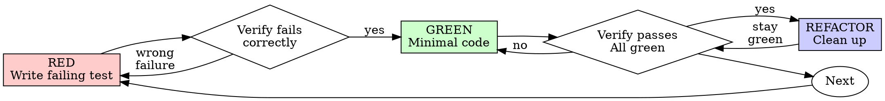

# Test-Driven Development (TDD)

## Overview

This is the experiment leg of the scientific loop. RED is the falsifiable prediction:
the failing test states what you expect the code to do and shows that the current code
does not do it. GREEN is the experiment — the cheapest run that can confirm or refute
that prediction. REFACTOR is the analysis leg, where the passing suite is the evidence
that behavior was preserved while the shape changed.

**Core principle: the failing test is the prediction that makes the work falsifiable.**
A test that never failed predicts nothing: it cannot distinguish "this code works" from
"this test would pass against anything". Watching it fail is what turns the test from a
description of intent into evidence — the failure names the behavior that is missing,
and its message tells you the failure is the one you expected rather than an accident of
setup.

The same reasoning settles the ordering question. Production code arrives only after a
test that failed for the expected reason; code written first and tested afterwards has
no prediction left to falsify, because the test is then shaped by the implementation it
is supposed to judge. That is the whole of the rule — not a ritual, but the difference
between a claim you can check and one you cannot.

## When to Use

**Always:**
- New features
- Bug fixes
- Refactoring
- Behavior changes

**Exceptions (ask your human partner):**
- Throwaway prototypes
- Generated code
- Configuration files

Thinking "skip TDD just this once" is itself the signal: the work is about to proceed
without a prediction. The loop checks below name that shape, and what to do about it.

## Red-Green-Refactor



### RED - Write Failing Test

Write one minimal test showing what should happen.

<Good>
```typescript
test('retries failed operations 3 times', async () => {
  let attempts = 0;
  const operation = () => {
    attempts++;
    if (attempts < 3) throw new Error('fail');
    return 'success';
  };

  const result = await retryOperation(operation);

  expect(result).toBe('success');
  expect(attempts).toBe(3);
});
```text
Clear name, tests real behavior, one thing
</Good>

<Bad>
```typescript
test('retry works', async () => {
  const mock = jest.fn()
    .mockRejectedValueOnce(new Error())
    .mockRejectedValueOnce(new Error())
    .mockResolvedValueOnce('success');
  await retryOperation(mock);
  expect(mock).toHaveBeenCalledTimes(3);
});
```
Vague name, tests mock not code
</Bad>

**Requirements:**
- One behavior
- Clear name
- Real code (no mocks unless unavoidable)

### Verify RED - Watch It Fail

**This step is the experiment; skipping it leaves the prediction untested.**

```bash
dotnet test tests/MyProject.Tests --filter MyTestName
```

Confirm:
- Test fails (not errors)
- Failure message is expected
- Fails because feature missing (not typos)

**Test passes?** You're testing existing behavior. Fix test.

**Test errors?** Fix error, re-run until it fails correctly.

**Capture the RED transcript** — the exact test command and the verbatim
failing output. Report formats downstream (implementer reports, code review)
require it as evidence you watched the fail; verbatim, not summarized.

### GREEN - Minimal Code

Write simplest code to pass the test.

<Good>
```typescript
async function retryOperation<T>(fn: () => Promise<T>): Promise<T> {
  for (let i = 0; i < 3; i++) {
    try {
      return await fn();
    } catch (e) {
      if (i === 2) throw e;
    }
  }
  throw new Error('unreachable');
}
```
Just enough to pass
</Good>

<Bad>
```typescript
async function retryOperation<T>(
  fn: () => Promise<T>,
  options?: {
    maxRetries?: number;
    backoff?: 'linear' | 'exponential';
    onRetry?: (attempt: number) => void;
  }
): Promise<T> {
  // YAGNI
}
```
Over-engineered
</Bad>

GREEN adds only what the test requires — no features, no refactoring, no "improvements" beyond it.

### Verify GREEN - Watch It Pass

**Run it and read the result; an unrun check is no evidence.**

```bash
dotnet test tests/MyProject.Tests --filter MyTestName
```

Confirm:
- Test passes
- Other tests still pass
- Output pristine (no errors, warnings)

**Test fails?** Fix code, not test.

**Other tests fail?** Fix now.

### REFACTOR - Clean Up

After green only:
- Remove duplication
- Improve names
- Extract helpers

Keep tests green; refactoring adds no behavior.

### Repeat

Next failing test for next feature.

## Good Tests

| Quality | Good | Bad |
|---------|------|-----|
| **Minimal** | One thing. "and" in name? Split it. | `test('validates email and domain and whitespace')` |
| **Clear** | Name describes behavior | `test('test1')` |
| **Shows intent** | Demonstrates desired API | Obscures what code should do |

When writing or changing any test, follow these rules to keep tests honest:
- Name the production change that would make the test fail — before writing it
- Assert on real behavior, never on mock behavior
- Keep test-only code in test utilities, out of production classes
- Understand a dependency's side effects before mocking it

## Predictions people get wrong

Each row is a prediction that feels true and is not. The right column says what the
evidence actually shows — which is why the loop is the faster path, not the slower one.

| Prediction | What the evidence shows |
|------------|-------------------------|
| "Too simple to test" | Simple code breaks too, and the test costs about 30 seconds. |
| "I'll test after" | A test written after passes immediately, and a pass with no prior fail is no evidence: it may assert the wrong thing, describe the implementation instead of the behavior, or miss the case you forgot — you never watched it fail, so you never saw it catch a bug. Test-first produces that failure. |
| "Tests after achieve same goals (spirit not ritual)" | Tests-after answer "what does this do?"; tests-first answer "what should this do?" A test written after is shaped by the code already there: it checks the cases you remembered, not the ones you would have discovered. Coverage without evidence the tests work. |
| "Already manually tested" | Manual testing is ad hoc — no record of what was covered, no way to re-run it when the code changes, and the awkward cases are the ones forgotten under pressure. "It worked when I tried it" is one observation, not a repeatable one. |
| "Deleting X hours is wasteful" | Sunk cost: those hours are spent either way. The real choice is rewriting with a prediction (high confidence) against keeping it and bolting tests on after (low confidence, likely bugs). Code you cannot trust is the waste. |
| "Keep as reference, write tests first" | You'll adapt it, which is testing after by another route — it has to go. |
| "Need to explore first" | Fine — throw the exploration away and start from a failing test. |
| "Test hard = design unclear" | The friction is data: hard to test means hard to use. |
| "TDD will slow me down" | The loop is the pragmatic path: bugs caught before commit, regressions prevented, refactoring without fear. The shortcut skips the prediction and pays for it in production debugging — slower, not faster. |
| "Manual test faster" | Manual checks prove nothing about edge cases, and every change means re-running them by hand. |
| "Existing code has no tests" | You're improving it — add tests for the existing code. |

## Loop checks — signals the prediction is missing

These are self-checks, not verdicts. Each one marks a place where the prediction is
missing — the work is proceeding without a check that could refute it. Catching one
means returning to RED with a better-stated prediction, not apologizing.

- Code written before its test — the change already exists, so any test written now is shaped by it.
- A test written after the implementation — it can pass, but it was never seen to fail, so it proves nothing about the behavior.
- A test that passes the first time it runs — either it covers existing behavior or it cannot separate working code from broken code.
- A failure you cannot explain — an unexplained failure is not a red; the prediction is not stated precisely enough to read the result.
- Tests deferred to "later" — later is after the code exists, which is testing after.
- "Just this once" — the exception is exactly the case where the missing prediction goes unnoticed until production.
- "I already manually tested it" — one ad-hoc observation, not a repeatable check.
- "Tests after achieve the same purpose" — they answer a different question: what the code does, not what it should do.
- "It's about spirit, not ritual" — the ritual is the evidence; without a watched failure there is nothing to appeal to.
- "Keep it as reference" or "adapt the existing code" — the reference becomes the implementation, which is testing after; do not read it while writing the test.
- "Already spent X hours, deleting is wasteful" — sunk cost; the time is gone either way and the untested code is the liability.
- "TDD is dogmatic, I'm being pragmatic" — the pragmatic path is the one with a check in it; skipping the prediction moves the cost to production.
- "This is different because..." — the exception is a hypothesis; name the observation that makes it true, or run the loop.

When one of these shows up, the next step is the same in every case: state the
prediction as a failing test, and let the failure tell you whether it is the right one.

## Example: Bug Fix

**Bug:** Empty email accepted

**RED**
```typescript
test('rejects empty email', async () => {
  const result = await submitForm({ email: '' });
  expect(result.error).toBe('Email required');
});
```

**Verify RED**
```bash
$ dotnet test --filter MyTestName
FAIL: expected 'Email required', got undefined
```

**GREEN**
```typescript
function submitForm(data: FormData) {
  if (!data.email?.trim()) {
    return { error: 'Email required' };
  }
  // ...
}
```

**Verify GREEN**
```bash
$ dotnet test --filter MyTestName
PASS
```

**REFACTOR**
Extract validation for multiple fields if needed.

## Verification Checklist

Before marking work complete:

- [ ] Every new function/method has a test
- [ ] Watched each test fail before implementing
- [ ] Kept the RED transcript: exact command + verbatim failing output
- [ ] Each test failed for expected reason (feature missing, not typo)
- [ ] Wrote minimal code to pass each test
- [ ] All tests pass
- [ ] Output pristine (no errors, warnings)
- [ ] Tests use real code (mocks only if unavoidable)
- [ ] Edge cases and errors covered

A box left unchecked is a gap in the evidence: the work is not yet verified, and the
missing check names what to do next.

## When Stuck

| Problem | Solution |
|---------|----------|
| Don't know how to test | Write wished-for API. Write assertion first. Ask your human partner. |
| Test too complicated | Design too complicated. Simplify interface. |
| Must mock everything | Code too coupled. Use dependency injection. |
| Test setup huge | Extract helpers. Still complex? Simplify design. |

## Debugging Integration

Bug found? Write failing test reproducing it. Follow TDD cycle. Test proves fix and prevents regression.

A bug fix without a test has no prediction behind it: the test proves the fix and
prevents the regression, so it comes first.

---

For the loop's routing across task types, see `scientific-method`. For the report leg —
fresh evidence before any completion claim — use `verification-before-completion`.
